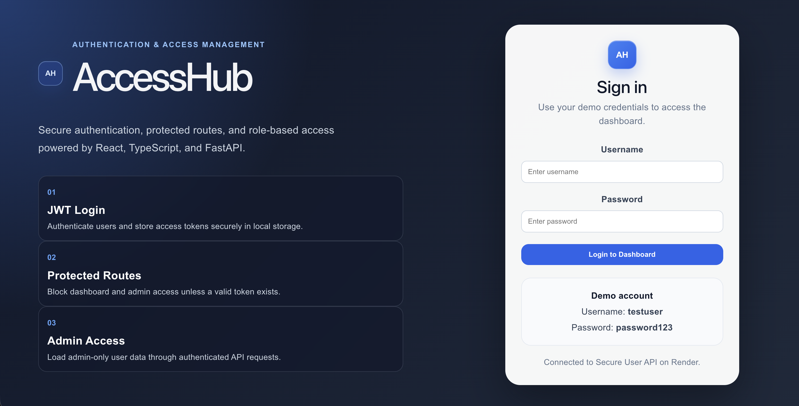
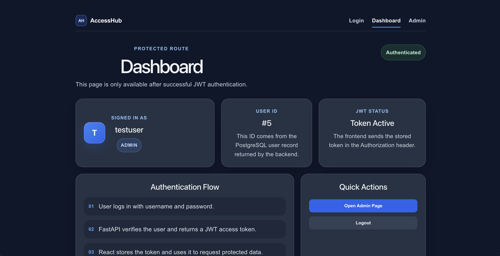
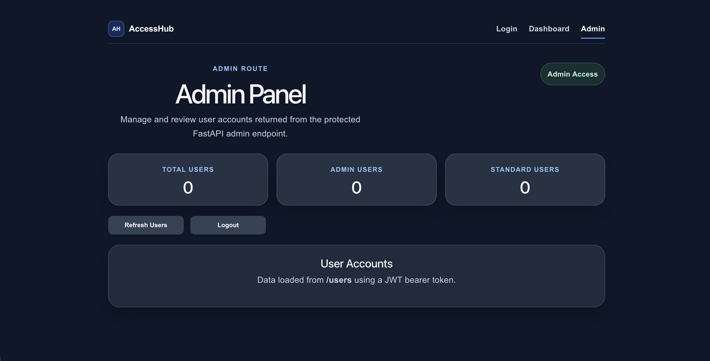

# AccessHub

AccessHub is a React and TypeScript authentication frontend connected to a deployed FastAPI backend.

## Live Demo

Frontend:

- [AccessHub](https://jwt-authentication-dashboard-sepia.vercel.app)

Backend API:

- [Secure User API Swagger Docs](https://mini-user-api.onrender.com/docs)

Related backend repository:

- [Secure User API](https://github.com/Iris408/secure-user-api)

## Current Status

| Area | Status |
| --- | --- |
| React / TypeScript frontend | ✅ Complete |
| Login flow | ✅ Working |
| JWT token storage | ✅ Working |
| Protected dashboard | ✅ Working |
| Admin user management | ✅ Working |
| Four-role permissions | ✅ Working |
| Loading and error states | ✅ Complete |
| Vercel deployment | ✅ Live |
| Render backend integration | ✅ Live |
| Frontend CI | ✅ Passing |
| Docker CI | ✅ Passing |

## Features

- User login flow
- JWT token storage
- Protected dashboard route
- Four roles — Admin, Manager, Member, Viewer / Auditor — with permissions
  enforced by the API and reflected in the interface
- User management for admins: add, edit role, deactivate, reactivate and
  permanently delete, with accessible confirmation dialogs
- One-time temporary passwords and a required password change at first sign-in
- Users table with search, role and status filters, sorting and pagination
- Light and dark themes and six interface languages
- Authenticated API requests
- API integration with deployed FastAPI backend
- Multi-page frontend routing
- Loading and error handling
- Responsive UI styling
- Vercel deployment
- Frontend and Docker CI workflows

## Screenshots

### Login Page



### Protected Dashboard



### Admin Panel



## Tech Stack

| Area | Technologies |
| --- | --- |
| Frontend | React, TypeScript, Vite, React Router, CSS |
| Backend API | FastAPI, PostgreSQL, SQLAlchemy, JWT authentication |
| Deployment | Vercel, Render |
| DevOps / Tooling | Docker, GitHub Actions, Git, GitHub |

## Quick Start

Clone the repository:

```bash
git clone https://github.com/Iris408/accesshub
cd accesshub
```

Install dependencies:

```bash
npm install
```

Create a `.env` file:

```env
VITE_API_URL=https://mini-user-api.onrender.com
```

Run locally:

```bash
npm run dev
```

Build check:

```bash
npm run build
```

## Documentation

More detailed project documentation is available in the `docs/` folder.

| Document | Description |
| --- | --- |
| [Setup Guide](./docs/setup.md) | Local setup, environment variables, build commands, and the isolated public demo |
| [Auth Flow](./docs/auth-flow.md) | JWT login, token storage, protected routes, and admin-only access |
| [Frontend Notes](./docs/frontend-notes.md) | Pages, UI behaviour, routing, loading states, and frontend improvements |
| [Project Details](./docs/project-details.md) | Architecture, related backend, limitations, future improvements, and learning notes |
| [CI Notes](./docs/ci.md) | Frontend CI and Docker CI workflow notes |

## Project Summary

AccessHub is a React and TypeScript authentication frontend demonstrating a complete JWT-based authentication and authorisation flow. It integrates with Secure User API to provide protected routing, role-based access, admin-only functionality, authenticated API requests, and production-style deployment using Vercel, Render, Docker, and GitHub Actions CI.

## Author

Built by Iris408